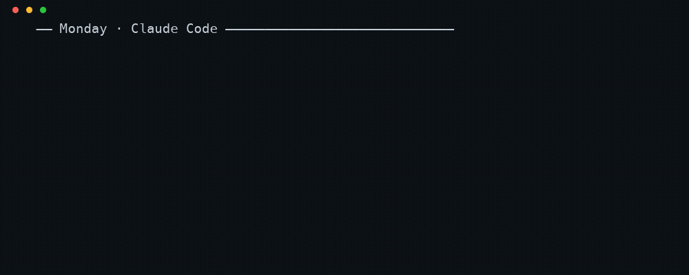
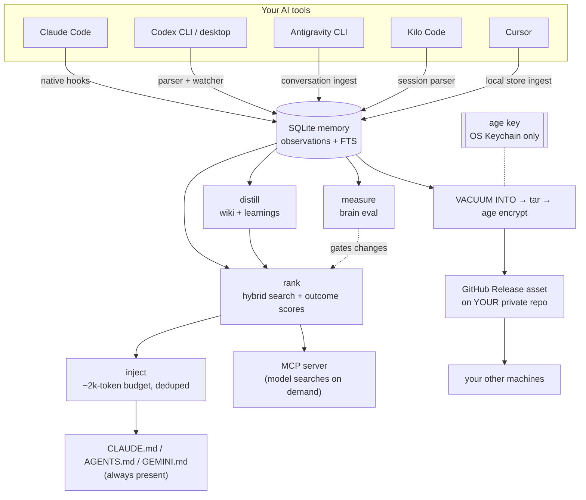

# Open Agentic Brain and Memory

**Open-source, self-hosted memory for every AI coding tool. Your AI's memory, in your
GitHub, encrypted with your key — not on someone's server.**

You tell Claude Code a decision. Tomorrow you're in Cursor, and it has no idea. Then Codex,
and you explain it a third time. Open Agentic Brain and Memory captures what your coding sessions actually
established, distills it, ranks it, and injects the relevant part back into every tool you
use — from one memory store that lives in **your own private GitHub repo**, encrypted with a
key that never leaves your machine's Keychain.



---

## The 90-second version

```
your AI tools  ──capture──►  one local SQLite memory
                                   │
                                   ├─ distill  → a compounding wiki + reusable "learnings"
                                   ├─ rank     → hybrid search (keywords + meaning) + outcome scores
                                   ├─ inject   → a ~2k-token block into CLAUDE.md / AGENTS.md / GEMINI.md
                                   └─ measure  → `brain eval` scores recall on your own history
                                   │
                              age-encrypted blob
                                   │
                        your private GitHub repo (Release asset)
                                   │
                              your other machines
```

- **One store, many tools.** Claude Code, Codex CLI and desktop, Antigravity CLI,
  Kilo Code (beta) and Cursor all read and write the same database.
- **Two ways in.** *Push* writes a digest into the global instructions file a tool auto-loads,
  so context is always present with zero action from you. *Pull* registers an MCP server so
  the model can search memory when it decides to. They are different, and this README keeps
  them apart — see the matrix.
- **You own the store.** The memory is an `age`-encrypted blob in a GitHub Release asset on
  *your* private repo. No vendor server sits in the path. Roughly 1.6 KB per observation
  compressed; a whole brain is tens of megabytes.
- **It measures itself.** `brain eval` asks ~20 questions about your own history and scores
  whether retrieval actually surfaced the answer. Changes to ranking or injection are gated
  on that number, not on vibes.

---

## What it actually is

A set of loops, not a chat product:

**capture → distill → rank → inject → measure → capture**

1. **Capture.** It captures every tool itself: purpose-built parsers read Claude Code,
   Codex, Antigravity CLI, Kilo Code and Cursor session files, and its own multi-provider
   distiller (Claude, Codex or Antigravity) turns them into memories in one local SQLite store
   (`~/.claude-brain/brain.db`). File watchers pick up new sessions
   near-live rather than waiting for a nightly job.
2. **Distill.** `brain dream` turns raw observations into a compounding wiki — pages that get
   revised, not appended. `brain distill` detects *resolved-struggle* sessions (a cluster of
   fixes to the same file followed by a resolution signal) and drafts a reusable "learning".
   Drafts are never auto-approved; you approve them from the UI.
3. **Rank.** Search is local and hybrid: SQLite FTS keyword ranking (BM25) fused with a small
   on-device embedding model, plus pseudo-relevance feedback and an opt-in cross-encoder
   rerank ("deep recall"). Learnings additionally carry outcome scores — how often a learning
   was injected, and whether you marked it helpful — so ranking reflects proven usefulness.
4. **Inject.** One assembler builds the context block for every tool: learnings → observations
   → workflows → wiki, deduped by content hash and a normalized-text fingerprint, inside a
   ~2k-token budget. It writes into managed `BRAIN:START/END` regions; anything you wrote
   yourself outside those markers is never touched.
5. **Measure.** `brain eval` scores retrieval against questions about your own history with
   verifiable evidence. It is the gate on every change to dream, ranking, or injection.

---

## Supported tools — what "supported" actually means

Three different things get bundled under "supported" and they feel completely different day
to day, so this table keeps them apart.

- **Capture** — do sessions in this tool flow *back into* the brain?
- **Push** — is a memory digest written into a global instructions file the tool auto-loads
  (`CLAUDE.md` / `AGENTS.md` / `GEMINI.md`)? If yes, context is **always present**, zero
  action from you.
- **Pull** — is the memory MCP server registered with the tool? If yes, the model *can*
  search memory — but only if it chooses to. Not automatic the way push is.

| Tool | Capture | Push | Pull |
|---|---|---|---|
| Claude Code | ✅ native | ✅ `CLAUDE.md` | ✅ |
| Codex CLI | ✅ parser + watcher | ✅ `AGENTS.md` | ✅ |
| Codex desktop app | ✅ (shares `~/.codex/`) | ✅ | ✅ |
| Antigravity CLI | ✅ conversation ingest + watcher | ✅ `GEMINI.md` | ✅ |
| Kilo Code (beta: VS Code, Cursor, CLI) | ✅ session parser | ✅ `~/.config/kilo/AGENTS.md` | ✅ |
| Cursor | ✅ ingested from its local store | ⚠️ per-repo `AGENTS.md` only | ✅ |
| Claude Desktop | ❌ | ❌ | ✅ |
| ChatGPT desktop app | ❌ | ❌ | ✅ |

**The ❌ cells are not roadmap items. They are architectural facts, and here is why:**

- **Claude Desktop capture is a hard no.** Its conversations live server-side. There is no
  local transcript store on disk to parse. Pull works via the documented
  `claude_desktop_config.json` MCP format.
- **ChatGPT desktop capture is a hard no by choice.** Its local history *is* on disk, but
  AES-encrypted with a Keychain-held key. Reading it would mean defeating another vendor's
  protection — that is circumvention, not integration, and this project will not ship it.
  Pull works because the ChatGPT desktop app shares MCP configuration with the Codex host
  (`~/.codex/config.toml`), so registering the memory server there covers it.
- **Neither has a push channel** because neither auto-loads a local instructions file.
  Nothing to write into.
- **Cursor push is per-repo, not global.** Cursor's Rules-for-AI live in its internal
  database and are deliberately left alone, so the brain reaches Cursor through a per-repo
  `AGENTS.md` — not one file that covers every project the way `CLAUDE.md` does.

If a vendor tells you a chat product is "supported" by a memory tool, it is worth asking
which of these three columns they mean.

---

## Install

Requires macOS or Linux, `git`, `node` (22+), and a GitHub account. The installer fetches
missing dependencies (`age`, `tar`, `gh`).

```bash
curl -fsSL https://raw.githubusercontent.com/rohithhn/Open-Agentic-Brain-and-Memory/main/install.sh | bash
```

The installer picks one of two modes:

- **INIT** — you have no brain yet. It clones this engine, then creates **your own** private
  data repo, generates your `age` key into the Keychain, and runs the first sync.
- **RESTORE** — you already have a brain on another machine. It clones your data repo, opens
  the local UI so you can paste your key, then downloads and decrypts the blob and rebuilds
  everything.

Two repos on purpose: the **engine** (this code, shared by everyone) and your **brain repo**
(your data, private, yours). They are never the same repo.

**What happens on first install:**

1. It asks whether to start your memory with the past sessions your AI tools already keep on
   this computer (recommended) or to start fresh. The answer is remembered, and every later
   capture honours it. Change it any time with `brain past-sessions on` / `off`.
2. It reads those sessions straight away and starts turning them into memories in the
   background, and tells you what it found (for example, how many sessions per tool and
   roughly how long the memory-building will take).
3. If you use claude-mem, it offers to bring that history over instantly (undo any time).
4. It wires every AI tool it finds and opens the control panel, which shows the progress.

### Quickstart

```bash
node bin/brain.mjs onboard   # wire THIS machine: MCP + profiles + watchers + daily sync
node bin/brain.mjs ingest    # pull in existing Claude Code / Codex / Antigravity / Kilo / Cursor sessions
node bin/brain.mjs dream     # distill observations into the wiki
node bin/brain.mjs eval      # score retrieval on your own history
node bin/brain.mjs doctor    # read-only check that every tool is wired and capturing
node bin/brain.mjs first-run # what was found, and how far memory-building has got
npm run serve                # control panel on http://127.0.0.1:37800
```

### Coming from claude-mem? One command moves you over

```bash
node bin/brain.mjs switch-from-claude-mem          # preview: shows what would be imported, wired and changed — writes nothing
node bin/brain.mjs switch-from-claude-mem --apply  # do it
node bin/brain.mjs switch-from-claude-mem --undo   # put claude-mem's settings back exactly as they were
```

`--apply` does three things, in order, and stops safely if any step fails:

1. **Imports your whole claude-mem history** into its own store. claude-mem's database is
   opened read-only, and the import is verified (every row and the search index) before anything else
   happens — an unverified import changes nothing else.
2. **Wires itself into every tool it finds**: Claude Code (plus its startup memory preview),
   Claude Desktop, Codex, Cursor, Antigravity and Kilo Code.
3. **Mutes claude-mem's startup memory dump** so you don't get two memory blocks at the start of every
   Claude Code session. Only that dump is muted (its settings are backed up first); claude-mem keeps
   running. Keep it if you like, or uninstall it — it captures Claude Code on its own.

Options: `--source <path>` imports a claude-mem database from somewhere else; `--no-silence` skips
step 3; `--json` prints the plan/result as JSON.

### Everyday commands

```bash
brain sync       # this machine → cloud (repo + encrypted blob Release asset)
brain restore    # cloud → this machine
brain merge      # merge remote memory into the local DB (multi-machine)
brain distill    # draft reusable learnings from resolved-struggle sessions
brain workflows  # mine recurring rituals into wiki/workflows/
brain status     # JSON status
brain key generate | import <AGE-SECRET-KEY-...> | show
```

### The control panel

`npm run serve` → `http://127.0.0.1:37800`. Search memory and open, pin, edit or delete any
memory; explore an interactive knowledge graph of your projects and the ideas that connect
them; follow first-run progress while your history becomes memories; browse the wiki; approve
or dismiss auto-distilled learnings and rate injected ones (that feedback drives ranking);
watch capture freshness, watchers and sync age; and run the eval.

---

## Architecture



**Why a Release asset and not git.** The blob is tens of megabytes and is replaced on every
sync. In git it would blow past the 100 MB file cap eventually and, via LFS, bill against a
1 GB free quota that cannot be selectively reclaimed — GitHub can't delete individual LFS
objects, so unreferenced blobs keep costing. Release assets are replaced in place
(`--clobber`), don't touch the LFS quota, and reclaim space on replacement.

**Where the encryption boundary sits.** Memory, wiki and learnings are encrypted — they hold
your secrets and your IP. Skills, agents and settings are plaintext — they're meant to be
readable and portable, and settings are redacted before commit. The `age` key lives only in
each machine's Keychain, never in git. A leaked repo or a leaked token exposes nothing
readable.

**What keeps it from eating your files.** Every write path is idempotent. Injected context
lives inside managed marker regions; human-authored content outside them is never modified.
MCP wiring is additive — it never touches server entries it didn't create.

**Testing.** 47 test suites (`npm test`) plus 4 sandbox simulations (`npm run test:sandbox`)
that install the real engine on fake machines with every supported tool, on macOS and Linux,
plus `brain eval` as a behavioral gate. It is tested, not proven at scale, and this README will
not pretend otherwise.

---

## Benchmarks

Measured with the product's own search; every answer and verdict is published so anyone can
recompute the numbers.

| Benchmark | Score | Setup |
|---|---|---|
| LongMemEval-S (500 questions, ~128k tokens of history each) | **94.2%** (93.4% with a GPT judge) | Claude Sonnet reader + judge, deep recall, 40 rounds |
| LongMemEval-M (500 questions, ~1.27M tokens of history each) | **83.0%** | gpt-6-luna reader + judge; the reader sees 98.5% fewer tokens than the history |
| LoCoMo (1,540 questions) | **86.6** (whole conversation: 89.3) | gpt-6-luna reader + judge for both; 97% of the full-context score at 18% of the tokens |

Details, method and per-question proof: [`evals/longmemeval/RESULTS.md`](./evals/longmemeval/RESULTS.md)
and [`evals/locomo/README.md`](./evals/locomo/README.md).

---

## How this differs from hosted memory services

Hosted memory products (Atlaso, mem0, and the memory built into ChatGPT and Claude) solve a
real problem well, and if you want zero setup they are the better choice today. The
difference here is architectural, not qualitative:

| | Hosted memory service | Open Agentic Brain and Memory |
|---|---|---|
| Where your memory lives | The vendor's database | A Release asset on your private GitHub repo |
| Who can read it | Vendor infrastructure, by design | Only whoever holds your `age` key |
| Encryption key custody | Vendor-managed | Your OS Keychain; never transmitted |
| Cost model | Per-seat subscription | Free; you pay GitHub nothing extra for a private repo |
| If the vendor shuts down | Export if they offer one | Nothing happens |
| Retrieval | Server-side semantic search | Local hybrid search (keywords + meaning) in milliseconds; **94.2% on LongMemEval-S** with opt-in deep recall (median ~2.4 s per query, see [RESULTS](./evals/longmemeval/RESULTS.md)); nothing leaves your machine |
| Sync | Continuous, but every change passes through the vendor's servers | **Instant and incremental on your machine.** Across machines: automatic daily sync of one encrypted file, merged memory by memory. GitHub only ever sees ciphertext; never what changed or when |
| Setup | Sign up, install extension | Install a CLI, hold a key, manage a repo |
| Uptime guarantee | Theirs | None. It's your machine. |

The last two rows are the costs on *this* side. That's the trade: you get ownership, privacy
and no bill, and you take on a little setup.

**On retrieval specifically:** search is local and hybrid: SQLite keyword ranking fused with a
small on-device embedding model (optional, ~23 MB), plus pseudo-relevance feedback and an
opt-in deep rerank for questions whose answer is spread over many memories. End-to-end
answer accuracy on LongMemEval-S is **94.2%** (93.4% with a GPT judge) with deep recall on,
with no server and no required runtime dependencies. Method,
code and every answer are in [`evals/`](./evals/longmemeval/RESULTS.md).

---

## Known limits

Stated plainly, because a comparison table nobody can falsify is worthless:

- **Early: used daily by 2–3 people so far.** It is tested (unit, sandbox and CI suites on
  macOS and Linux), but not yet battle tested by a wide user base.
- **macOS and Linux** (verified on Debian with libsecret + systemd user units). Windows is not
  supported yet.
- **Cross-machine sync uploads the whole encrypted file**, not just the changes. That is the
  price of GitHub never seeing what changed; on very large brains (hundreds of MB) a sync takes
  longer. Local capture and search are incremental and instant.
- **Multi-machine is merge-based**, not real-time. If you edit memory on two machines
  simultaneously, `brain merge` reconciles on next run — it does not resolve live conflicts.
- **Meaning-based search needs the optional on-device model** (installed by default, ~23 MB).
  Without it, search falls back to keywords only, and paraphrased questions with no
  overlapping words are the failure mode.
- **Session formats change.** Capture reads each tool's local files, and vendors change those
  formats without notice; `brain doctor` flags a tool whose capture has gone stale.
- **Two tools are pull-only forever** (Claude Desktop, ChatGPT desktop) for the architectural
  reasons above.
- **Cursor push is per-repo**, so a new Cursor project starts without the digest until you
  wire it.

## License

[Apache License 2.0](LICENSE). Free to use, modify and share, including at work. See
[`NOTICE`](NOTICE) for copyright and [`CONTRIBUTING.md`](CONTRIBUTING.md) for contributor terms.
